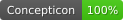
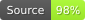

# Modified Swadesh-100 list of 23 Cariban languages

## How to cite

If you use these data please cite
- the original source
  > Matter, Florian. 2020. Comparative Cariban Database. Leipzig: Max Planck Institute for Evolutionary Anthropology. (Available online at https://cariban.clld.org/)
- the derived dataset using the DOI of the [particular released version](../../releases/) you were using

## Description

This list contains 2241 lexical entries for 23 Cariban languages. The concepts are based on Meira & Franchetto (2005) (doi:10.1086/491633), with the following modifications: ‘vein’ was removed, as it is usually identical to ‘root’; 'lie', 'sit', and 'stand' were removed, as there are usually no dedicated verbs in Cariban languages.

This dataset is licensed under a CC-BY-4.0 license

Available online at https://cariban.clld.org/morphemes#swadesh

## Statistics

- **Varieties:** 25 (linked to 25 different Glottocodes)
- **Concepts:** 96 (linked to 96 different Concepticon concept sets)
- **Lexemes:** 2,418
- **Sources:** 983
- **Synonymy:** 1.05
- **Invalid lexemes:** 0
- **Tokens:** 11,693
- **Segments:** 43 (0 BIPA errors, 0 CLTS sound class errors, 43 CLTS modified)
- **Inventory size (avg):** 19.52

## Possible Improvements:

- Entries missing sources: 49/2418 (2.03%%)

# Contributors

Name | GitHub user | Role
--- | --- | ---
Florian Matter | @fmatter | maintainer

## CLDF Datasets

The following CLDF datasets are available in [cldf](cldf):

- CLDF [Wordlist](https://github.com/cldf/cldf/tree/master/modules/Wordlist) at [cldf/cldf-metadata.json](cldf/cldf-metadata.json)